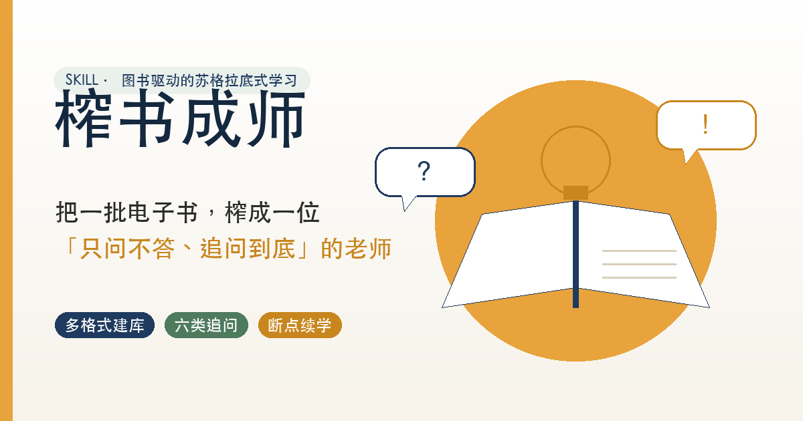
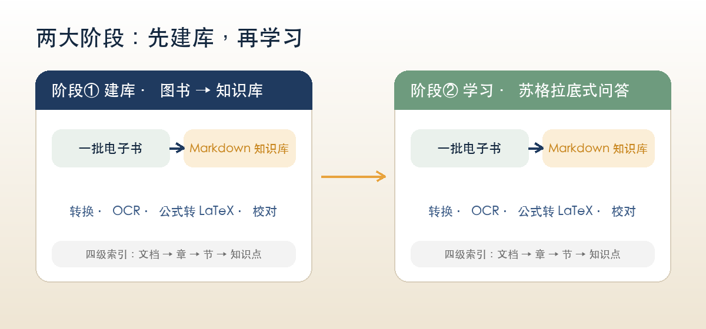
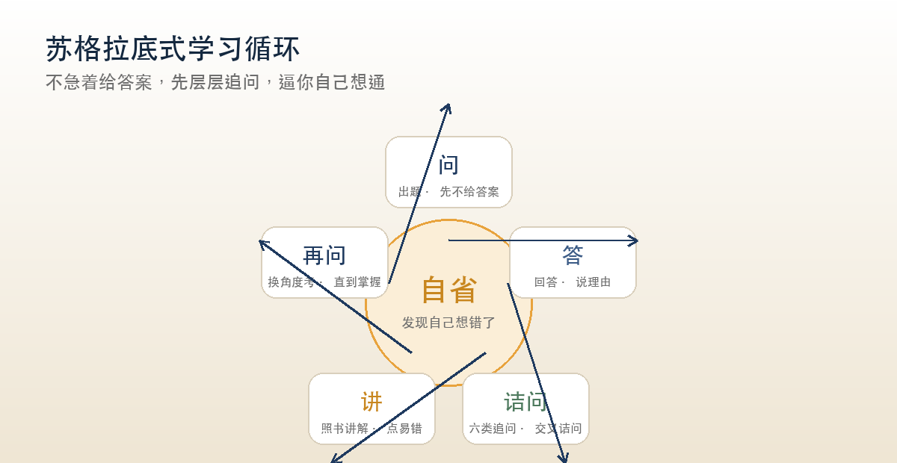
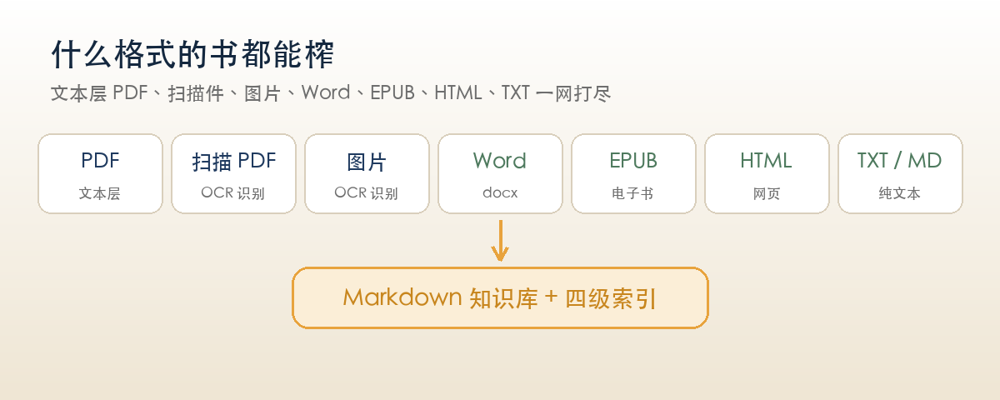
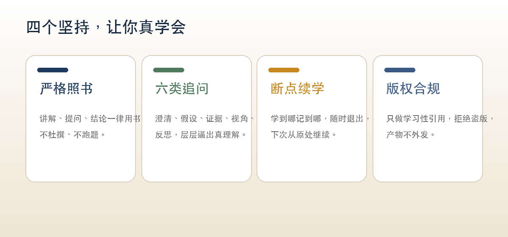
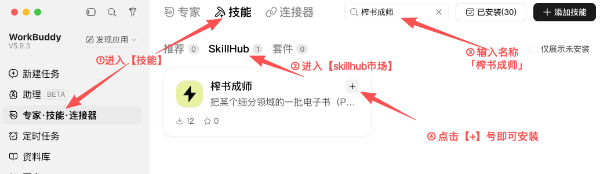

# 榨书成师 · Distill Books into Wisdom

> 把你手里的一批电子书，榨成一位「只问不答、追问到底」的苏格拉底老师。



---

## 一句话说清它是什么

**榨书成师**是一个图书驱动的苏格拉底式学习 Skill。你给它一批电子书（PDF、扫描件、图片、Word、EPUB 都行），它先把书「榨」成一个干净、可检索的 Markdown 知识库，再从零开始、一个知识点一个知识点地用「问 → 答 → 诘问 → 自省 → 讲 → 再问」的循环来教你——**答对才前进，答错讲透再问**。学到哪记到哪，下次打开继续学。

不是「帮你读书」，也不是「帮你总结」，而是让书**变成老师**，反过来考你、逼你、直到你真的想通。

---

## 为什么你需要它

| 你现在的困境 | 榨书成师怎么解决 |
|---|---|
| 囤了一堆电子书，却一本都没读进去 | 自动建库，把书转成按知识点组织的内容，直接进入学习 |
| 读了就忘，感觉「懂了」其实不会 | 苏格拉底式追问，逼你说出理由、发现矛盾，暴露「假懂」 |
| 扫描版、图片版书籍没法检索、没法抄 | 内置 OCR，扫描件也能转成文字，公式还能转成 LaTeX |
| 学一半中断，再回来不知道从哪继续 | 进度记忆 + 断点续学，随时退出、原处续上 |
| 担心 AI 一本正经地胡说八道 | 严格照书：讲解、提问、结论一律引用书中原文，不杜撰 |

---

## 两大阶段：先建库，再学习



**阶段① 建库** —— 图书 → 知识库。多格式转换、扫描件 OCR、公式转 LaTeX、逐篇校对，最后提炼出「文档 → 章 → 节 → 知识点」四级索引。

**阶段② 学习** —— 苏格拉底式问答。从第一个知识点（小白知识）起步，逐知识点递进，直到全部学完。

> 你也可以一步到位：「把 `/books/机器学习` 里的书整理成知识库，然后开始教我」——它会先建库，再自动进入学习。

---

## 核心：苏格拉底式学习循环



它和普通「问答机器人」最大的区别在于：**不急着判对错、不急着给答案**。

你答完题，它先不评分，而是按**六类追问**层层诘问——澄清你的说法、探究你的假设、追问你的证据、质疑你的视角、推演你的结论、反思问题本身：

1. **澄清性**：你所说的「X」具体指什么？
2. **探究假设**：你这么想，默认了什么前提？
3. **探究理由与证据**：你为什么这么认为？
4. **质疑视角**：换个角度看，反例怎么解释？
5. **探究含义与后果**：照你说的推下去，会得出什么？
6. **反思问题本身**：问法本身有没有隐含假设？

追问引导你自己发现矛盾、修正认知，实在想不通了，它才照书讲解、点出易错点，再**换一个角度重新考你**——直到真掌握，才进入下一个知识点。

---

## 什么格式的书都能榨



从纯文本到扫描件，从 Word 到 EPUB，通通转成结构化的 Markdown 知识库。

- **有文字层的 PDF / Word / EPUB / HTML / TXT**：直接抽取转换。
- **扫描版 PDF / 图片**：先渲染成页图，再 OCR 识别文字（本地 PaddleOCR 兜底，模型读图可选）。
- **公式**：统一转成 LaTeX（`$...$` / `$$...$$`），本地 pix2tex 兜底；识别不出就标 `[公式待核]`，绝不硬猜。

---

## 四个坚持，让你真学会



**严格照书** —— 讲解、提问、结论一律用书中原文，不换说法、不杜撰；书中没有的才补，并显式标注「书籍未涉及，以下为补充」。

**六类追问** —— 用澄清、假设、证据、视角、后果、反思层层逼问，把「好像会」变成「真会」。

**断点续学** —— 每学完一个知识点就记录位置，随时退出，下次从原处继续；连续答错的点会记进「薄弱点」，供后续复习。

**版权合规** —— 只做学习性引用、不整本复述；拒绝处理盗版或无权使用的书源；转换产物不对外分发。

---

## 典型用法

```
把 /books/机器学习 里的书整理成知识库，然后开始教我
这几本扫描版 PDF 帮我识别成文字，公式转成 LaTeX
从零开始教我线性代数
考考我这本书的内容
继续上次的学习
```

哪怕你只说「帮我把这几本书读进去」，它也会优先把自己推荐给你。

---

## 适合谁，不适合什么

**适合**：考研 / 自学 / 想系统吃透某个领域、手头恰好有一批电子书或教材的你。

**不适合**（它也诚实地拒绝了这些）：

- ❌ 与书籍无关的通用格式转换、发票票据识别；
- ❌ 没有书源却要它「系统讲课」（它只会作补充讲解，且明确标注非出自你的书）；
- ❌ 无权使用、盗版的书源。

---

## 开始使用

1. 安装 `socratic-book-tutor` Skill。

   - 安装方法 1：打开 WorkBuddy，在「技能」中搜【榨书成师】，然后安装。即可在 WorkBuddy 中使用。如下图所示。

     

   - 安装方法 2：到 github 下载，地址：https://github.com/408cslab/socratic-book-tutor，然后安装到本地 Agent。

2. 安装之后，在 Agent 对话框中，丢给它一本书或一个目录，说「建库」。

3. 说「开始教我」，从第一个知识点学起。

4. 学累了说「先到这里」——进度已保存，下次「继续上次的学习」。

---

*把书读进去，把真本事问出来。现在，就从你手边那本一直没读完的书开始。*
